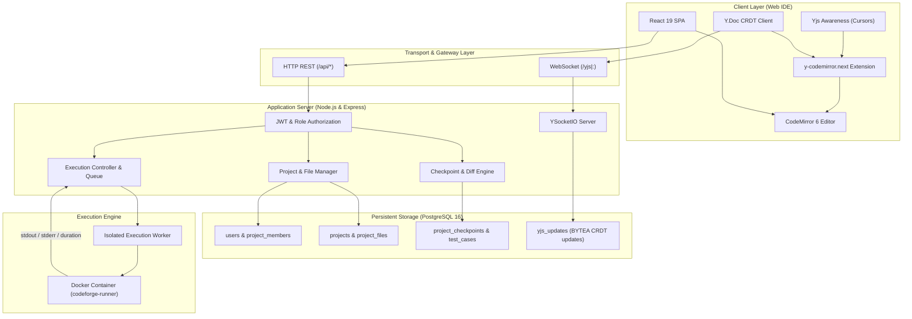
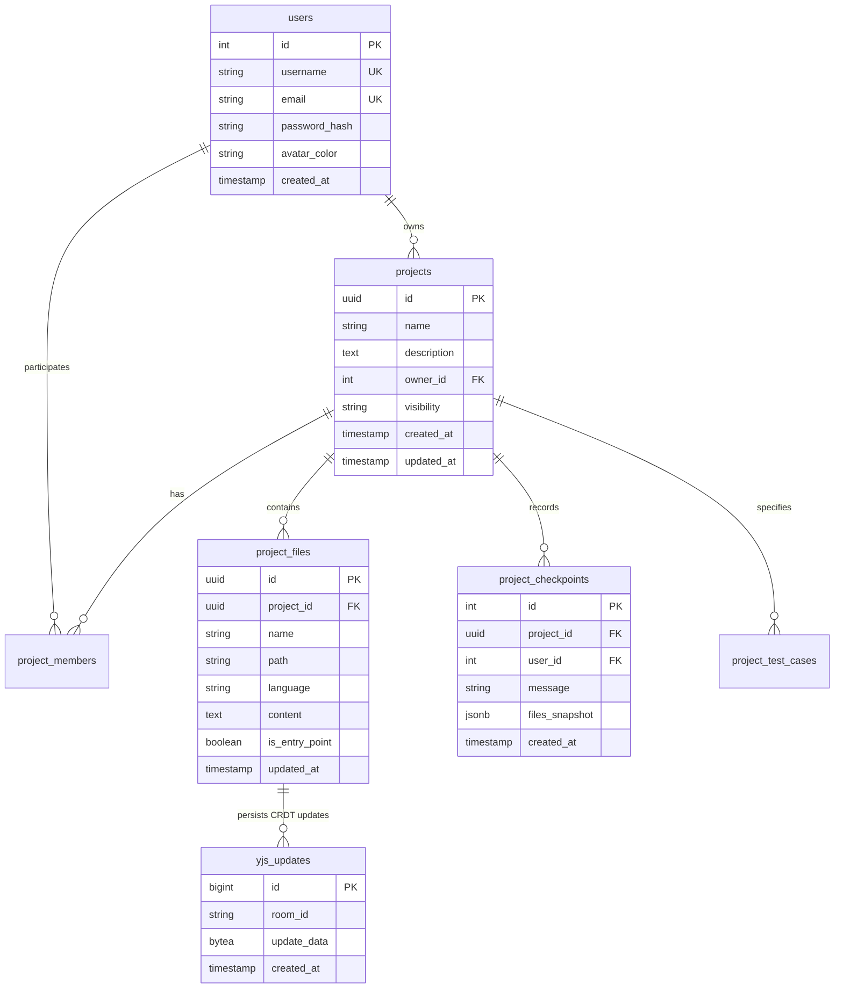
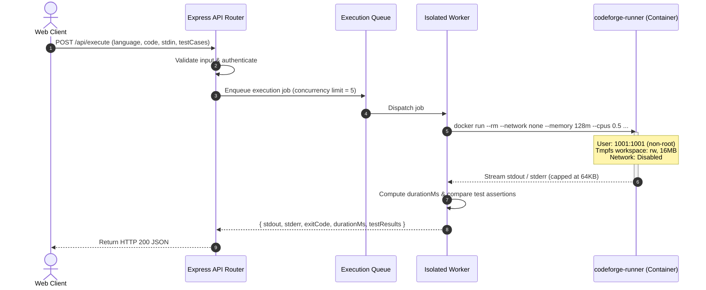
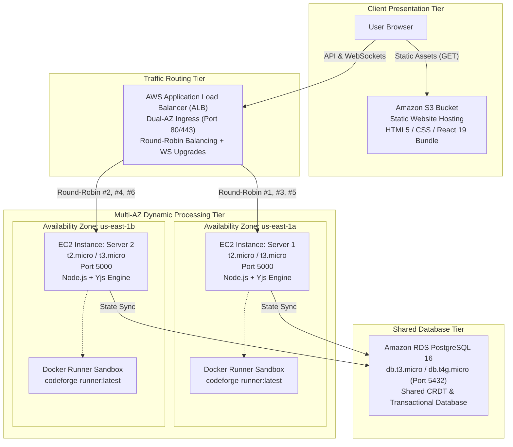

# CodeForge — System Architecture & Design Specification

**Document Version:** 2.0.0  
**Target Platform:** CodeForge Real-Time Collaborative Development Environment  

---

## 1. Architectural Overview

CodeForge is engineered as a multi-tier, distributed, and resilient collaborative IDE platform. It decouples high-frequency real-time document synchronization (via CRDTs over WebSockets) from persistent transactional business logic (RESTful API over PostgreSQL) and untrusted program execution (isolated container sandbox worker).

---

## 2. Collaborative Synchronization Subsystem (Yjs CRDT)

### 2.1. Scoping and Document Namespacing
Rather than treating an entire room as a single flat string buffer, CodeForge namespaces collaborative documents per project and file:
$$\text{Room Identifier} = \text{projectId} : \text{fileId}$$

- **Namespace Routing:** Socket connections connect to `io(/^\/yjs\|.*$/)`. The document name is derived by stripping `/yjs|`.
- **CRDT Document Lifecycle:**
  1. On first client join, `YSocketIO` invokes `setupYjsPersistence.initDocument()`.
  2. The server acquires a per-room lock (`initLocks`) to eliminate duplicate simultaneous instantiation race conditions.
  3. All historical binary updates for that room are loaded sequentially from `yjs_updates` in PostgreSQL (`ORDER BY id ASC`) and merged into the server's in-memory `Y.Doc`.
  4. The client receives the synchronized document vector and applies subsequent diffs.

### 2.2. Concurrency & Convergence
Yjs operates as an operation-based and state-based Conflict-Free Replicated Data Type. Edits made by multiple clients concurrently are deterministically resolved via internal Lamport timestamps and unique client IDs:
- **No Broadcast Flooding:** Only binary delta updates (`update_data BYTEA`) are transmitted over the wire rather than the entire document string.
- **Durable Write Queue:** Each room maintains a serialized promise write queue (`writeQueues`) ensuring asynchronous database writes to `yjs_updates` are executed without data interleaving or out-of-order writes.
- **Server Restart Resilience:** Because state is continuously persisted as CRDT deltas, if the backend server crashes or restarts, subsequent client reconnections reconstruct the converged state with 0% data loss.

---

## 3. Data Storage & Schema Design

PostgreSQL 16 serves as the single source of truth for both relational application entities and CRDT state.

### Entity Relationship Model

---

## 4. Isolated Execution Engine

The code execution boundary is isolated behind a dedicated execution worker (`services/isolatedRunner.js`).

### Security Boundary Guarantees:
1. **Network Denial:** `--network none` prevents all outbound network requests, SSRF, reverse shells, or botnet attacks.
2. **Process Sandboxing:** `--pids-limit 64` prevents fork bombs.
3. **Memory Ceilings:** `--memory 128m` with swap disabled prevents memory exhaustion DoS.
4. **CPU Restrictions:** `--cpus 0.5` throttles compute-heavy mining loops.
5. **Least Privilege Identity:** Containers execute under non-root UID `1001:1001` (`runner`).
6. **Ephemeral Lifetime:** `--rm` guarantees containers are destroyed on termination.

---

## 5. Version History & Checkpointing

- **Snapshot Ingestion:** Checkpoints capture a full semantic JSON snapshot of all project files (`files_snapshot JSONB`) indexed by file UUID.
- **Textual Diffing:** Textual differences are generated using the Myers diff algorithm (`diff` library). Both raw patches (`createPatch`) and structured line-by-line colored diffs (`diffLines`) are computed on demand.
- **Non-Destructive Restoration:** When a user restores Checkpoint #K, CodeForge restores file records in PostgreSQL and updates the shared Yjs document state. Crucially, it records a **new Checkpoint #N** stating `"Restored from Checkpoint #K"`, preserving a continuous, unalterable historical audit trail.

---

## 6. AWS Cloud Architecture Deployment (VIT BCSE355L QP 1)

CodeForge has been engineered specifically for the **VIT University Fall Semester 2026-2027 Case Study QP 1** (BCSE355L - Cloud Architecture Design).

### 6.1. Architectural Tier Breakdown
1. **Presentation Tier (Amazon S3):**
   - Pure static client bundle generated by Vite (`dist/index.html`, `dist/assets/*`).
   - S3 Static Website Hosting configured with public read bucket policy (`aws/s3-bucket-policy.json`) and permissive CORS (`aws/s3-cors.json`).
   - Zero compute costs on the presentation layer.

2. **Ingress & Traffic Routing Tier (AWS ALB):**
   - Internet-facing Application Load Balancer deployed across subnets in `us-east-1a` and `us-east-1b`.
   - Distributes incoming traffic using the round-robin routing algorithm.
   - Target group performs active health checking on `/api/health` with 5s timeout and 30s probe intervals.
   - Forwards WebSocket upgrade handshakes (`Upgrade: websocket`) for real-time CRDT synchronization.

3. **Compute Tier (Dual EC2 Instances in Multi-AZ):**
   - Two EC2 instances (`Server1` in `us-east-1a` and `Server2` in `us-east-1b`).
   - Provisioned automatically via cloud-init / user data scripts (`aws/setup-server1.sh`, `aws/setup-server2.sh`).
   - Managed as resilient systemd daemon services (`codeforge.service`).
   - Both nodes inject live telemetry response headers:
     * `X-Instance-ID`: Node identifier (e.g. `ec2-server1-us-east-1a`)
     * `X-Served-By`: Node role and hostname
     * `X-Availability-Zone`: Geographical AZ (e.g. `us-east-1a` / `us-east-1b`)

4. **Persistence Tier (Amazon RDS PostgreSQL 16):**
   - Central relational database shared by both compute nodes.
   - Decoupled from node lifecycles so any server can terminate or restart without state disruption.
   - Stores users, projects, files, checkpoints, test cases, and sequential Yjs binary CRDT update logs.

5. **Live Verification & Diagnostic Toolkit:**
   - **In-App ALB Modal:** Navigation bar badge and interactive prober with 1-click round-robin verification.
   - **PowerShell Prober:** `aws/verify-alb.ps1` for Windows environments.
   - **Bash Prober:** `aws/verify-alb.sh` for Linux/macOS environments.
   - **Local Multi-AZ Simulator:** `start-aws-cluster.bat` & `docker-compose.aws-simulation.yml`.

