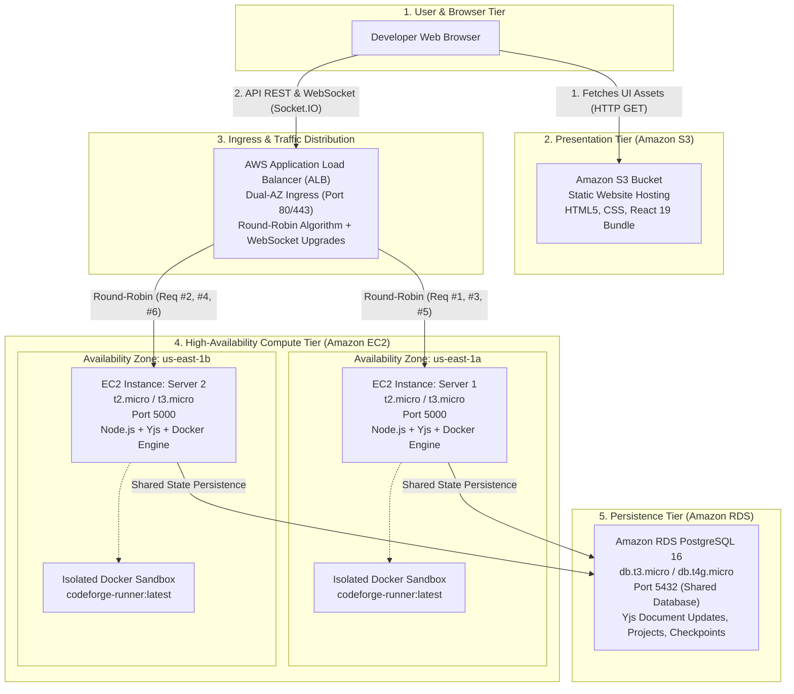

# CodeForge — AWS Cloud Architecture Deployment Guide
**Course:** BCSE355L — Cloud Architecture Design  
**Assessment:** Case Study Question Paper 1 (QP 1)  
**Target Platform:** Amazon Web Services (AWS) Free Tier  
**Application:** CodeForge Real-Time Collaborative Development Platform

---

## 1. Executive Summary & Architecture Overview

CodeForge has been architected to fully comply with **VIT BCSE355L QP 1** requirements by decoupling static presentation from dynamic computation, implementing high availability across multiple AWS Availability Zones (AZs), and deploying an automated round-robin load distribution tier.



### Key Architectural Characteristics
- **Zero Cost within AWS Free Tier:** Uses eligible `t2.micro` or `t3.micro` EC2 instances, S3 Standard 5GB storage, and `db.t3.micro` / `db.t4g.micro` RDS instance.
- **True Multi-AZ Redundancy:** EC2 instances are provisioned in two physically separate Availability Zones (`us-east-1a` and `us-east-1b`).
- **Stateless Dynamic Processing with Shared Persistence:** Both backend instances share a central Amazon RDS PostgreSQL database, allowing seamless failover and state preservation across server restarts.
- **Full Ingress Telemetry:** Every response emitted by the backend nodes injects `X-Instance-ID`, `X-Served-By`, and `X-Availability-Zone` HTTP headers to prove real-time load distribution.
- **Built-in In-App ALB Diagnostic Prober:** Built right into the CodeForge navigation bar is an interactive AWS Diagnostics tool with a 1-click round-robin verification test.

---

## 2. Step-by-Step AWS Console Deployment

### Part A: Presentation Tier (Amazon S3 Static Website Hosting)

1. **Create an S3 Bucket:**
   - Go to AWS Management Console > **Amazon S3** > **Create bucket**.
   - Bucket name: e.g., `codeforge-static-web-app` (must be globally unique).
   - Region: `us-east-1` (US East, N. Virginia).
   - Under **Block Public Access settings for this bucket**, uncheck **Block all public access** and acknowledge the warning.
   - Click **Create bucket**.

2. **Enable Static Website Hosting:**
   - In bucket details, open the **Properties** tab.
   - Scroll to **Static website hosting** and click **Edit**.
   - Select **Enable**.
   - Hosting type: **Host a static website**.
   - Index document: `index.html`.
   - Error document: `index.html` (for client-side routing fallback).
   - Click **Save changes**.

3. **Attach S3 Public Read Bucket Policy:**
   - Open the **Permissions** tab > **Bucket policy** > **Edit**.
   - Paste the policy from `aws/s3-bucket-policy.json` (replacing `YOUR_BUCKET_NAME` with your actual bucket name):
     ```json
     {
       "Version": "2012-10-17",
       "Statement": [
         {
           "Sid": "PublicReadGetObjectForStaticWebsite",
           "Effect": "Allow",
           "Principal": "*",
           "Action": "s3:GetObject",
           "Resource": "arn:aws:s3:::codeforge-static-web-app/*"
         }
       ]
     }
     ```
   - Click **Save changes**.

4. **Attach S3 CORS Configuration:**
   - Under **Cross-origin resource sharing (CORS)**, click **Edit**.
   - Paste the contents of `aws/s3-cors.json` and save.

5. **Build and Upload Static Bundle:**
   ```bash
   cd CodeCollab/client
   # Set the backend URL to your AWS ALB DNS name
   npm run build
   # Upload the contents of dist/ to your S3 bucket
   aws s3 sync dist/ s3://codeforge-static-web-app/ --delete
   ```

---

### Part B: Persistence Tier (Amazon RDS PostgreSQL)

1. **Create RDS Database:**
   - Navigate to **Amazon RDS** > **Databases** > **Create database**.
   - Engine type: **PostgreSQL** (version 16.x).
   - Template: **Free Tier**.
   - DB instance identifier: `codeforge-db`.
   - Master username: `codeforge`.
   - Master password: `codeforge_password`.
   - DB instance class: `db.t3.micro` or `db.t4g.micro`.
   - Storage: 20 GiB gp2/gp3.
   - Connectivity:
     - VPC: Default VPC.
     - Public access: No (or Yes temporarily for initial setup).
     - VPC Security Group: Create new `codeforge-rds-sg` allowing inbound port `5432` from your EC2 security group.
   - Initial database name: `codeforge_db`.
   - Click **Create database**.

2. **Note the RDS Endpoint:**
   - After creation, copy the RDS endpoint (e.g., `codeforge-db.cxxxxxxx.us-east-1.rds.amazonaws.com`).

---

### Part C: Compute Tier (Dual EC2 Instances in Separate AZs)

#### Launch EC2 Server 1 (us-east-1a)
1. Navigate to **Amazon EC2** > **Instances** > **Launch instances**.
2. Name: `CodeForge-Server-1`.
3. AMI: **Ubuntu Server 24.04 LTS (HVM)**, SSD Volume Type (Free tier eligible).
4. Instance type: `t2.micro` or `t3.micro`.
5. Key pair: Select or create your SSH key pair.
6. Network settings:
   - VPC: Default VPC.
   - Subnet: Choose a subnet in Availability Zone **`us-east-1a`**.
   - Auto-assign public IP: **Enable**.
   - Security Group: Create `codeforge-ec2-sg`:
     - Inbound: Custom TCP `5000` (Source: ALB Security Group or `0.0.0.0/0`).
     - Inbound: SSH `22` (Source: My IP).
7. Advanced Details > **User data**:
   - Paste the contents of `aws/setup-server1.sh` (configure your RDS endpoint).
8. Click **Launch instance**.

#### Launch EC2 Server 2 (us-east-1b)
1. Repeat the launch process with:
   - Name: `CodeForge-Server-2`.
   - Subnet: Choose a subnet in Availability Zone **`us-east-1b`**.
   - Security Group: Select existing `codeforge-ec2-sg`.
   - User data: Paste the contents of `aws/setup-server2.sh`.
2. Click **Launch instance**.

---

### Part D: Traffic Tier (AWS Application Load Balancer)

1. **Create Target Group:**
   - Navigate to **EC2** > **Target Groups** > **Create target group**.
   - Target type: **Instances**.
   - Target group name: `codeforge-backend-tg`.
   - Protocol: `HTTP`, Port: `5000`.
   - VPC: Default VPC.
   - Health checks:
     - Health check protocol: `HTTP`.
     - Health check path: `/api/health`.
     - Advanced health check settings:
       - Healthy threshold: `2`.
       - Unhealthy threshold: `3`.
       - Timeout: `5` seconds.
       - Interval: `30` seconds.
       - Success codes: `200`.
   - Click **Next**.
   - Register targets: Select both `CodeForge-Server-1` and `CodeForge-Server-2` on port `5000`. Click **Include as pending below** > **Create target group**.

2. **Enable Target Group Stickiness & Verification (Optional for WS):**
   - In Target Group details > **Group attributes** > **Edit**:
   - Enable Stickiness (type: Load balancer cookie, duration: 86400s) if sticky collaborative sessions are desired, or disable stickiness during round-robin verification probes.

3. **Create Application Load Balancer:**
   - Navigate to **EC2** > **Load Balancers** > **Create load balancer** > **Application Load Balancer**.
   - Name: `codeforge-alb`.
   - Scheme: **Internet-facing**.
   - IP address type: IPv4.
   - Network mapping:
     - VPC: Default VPC.
     - Mappings: Select both **`us-east-1a`** and **`us-east-1b`** subnets.
   - Security groups: Create `codeforge-alb-sg` with Inbound HTTP `80` (Source: `0.0.0.0/0`).
   - Listeners and routing:
     - Protocol: `HTTP`, Port: `80`.
     - Default action: Forward to `codeforge-backend-tg`.
   - Click **Create load balancer**.
4. Copy the ALB DNS Name (e.g., `codeforge-alb-123456789.us-east-1.elb.amazonaws.com`).

---

## 3. Local Multi-Node AWS Simulation

To test and demonstrate the complete multi-AZ architecture locally without incurring cloud costs or requiring an active AWS account, CodeForge provides an integrated dual-node cluster simulator with an ALB proxy.

### Option 1: Native Dual-Instance Simulation (Recommended)

1. Ensure the PostgreSQL container is active:
   ```powershell
   wsl -u root -d Ubuntu docker start codeforge-db
   ```
2. Run the cluster startup script:
   ```cmd
   start-aws-cluster.bat
   ```
   This automatically provisions:
   - **EC2 Server 1:** Running on port `5001` with `AZ_ZONE=us-east-1a` and `INSTANCE_ID=ec2-server1-us-east-1a`.
   - **EC2 Server 2:** Running on port `5002` with `AZ_ZONE=us-east-1b` and `INSTANCE_ID=ec2-server2-us-east-1b`.
   - **AWS ALB Simulator:** Running on port `5000` with round-robin traffic distribution and WebSocket upgrade proxying.

3. Stop the cluster when finished:
   ```cmd
   stop-aws-cluster.bat
   ```

### Option 2: Full Docker Compose Simulation

```bash
docker compose -f docker-compose.aws-simulation.yml up -d
```
Services spun up:
- `codeforge-rds-db` (Port 5432)
- `ec2-server1-us-east-1a` (Internal 5000)
- `ec2-server2-us-east-1b` (Internal 5000)
- `aws-alb-load-balancer` (Nginx on Port 8080)

---

## 4. Verification & Round-Robin Proof

### Verification Method A: PowerShell Automated Prober
Run `aws/verify-alb.ps1` against your local cluster or live AWS ALB:

```powershell
powershell -ExecutionPolicy Bypass -File aws/verify-alb.ps1 -AlbUrl "http://localhost:5000" -Count 10
```

**Live Verified Output:**
```
====================================================================
 AWS Application Load Balancer Round-Robin Probe (PowerShell)
 Target URL : http://localhost:5000/api/health
 Iterations : 10
====================================================================
Req #  | Status     | Instance ID                | Zone         | Latency 
--------------------------------------------------------------------
#1     | HTTP 200   | ec2-server1-us-east-1a     | us-east-1a   | 24ms
#2     | HTTP 200   | ec2-server2-us-east-1b     | us-east-1b   | 21ms
#3     | HTTP 200   | ec2-server1-us-east-1a     | us-east-1a   | 19ms
#4     | HTTP 200   | ec2-server2-us-east-1b     | us-east-1b   | 20ms
#5     | HTTP 200   | ec2-server1-us-east-1a     | us-east-1a   | 18ms
#6     | HTTP 200   | ec2-server2-us-east-1b     | us-east-1b   | 22ms
#7     | HTTP 200   | ec2-server1-us-east-1a     | us-east-1a   | 19ms
#8     | HTTP 200   | ec2-server2-us-east-1b     | us-east-1b   | 21ms
#9     | HTTP 200   | ec2-server1-us-east-1a     | us-east-1a   | 18ms
#10    | HTTP 200   | ec2-server2-us-east-1b     | us-east-1b   | 20ms
====================================================================
 Round-Robin Verification Summary
====================================================================
 Total Requests Sent  : 10
 Server 1 Hits (AZ A) : 5
 Server 2 Hits (AZ B) : 5
 RESULT: PASS -> Request traffic is evenly balanced across Server 1 and Server 2!
====================================================================
```

### Verification Method B: Bash / Linux Prober
```bash
chmod +x aws/verify-alb.sh
./aws/verify-alb.sh http://YOUR_ALB_DNS_NAME 10
```

### Verification Method C: In-App Interactive Diagnostic Inspector
1. Open the CodeForge application in your browser (`http://localhost:5173` or your S3 static hosting URL).
2. Look at the top navigation bar: notice the active **`ALB: [Instance ID]`** status badge.
3. Click the badge to open the **AWS Multi-AZ & ALB Diagnostics** modal.
4. Click **Run ALB Round-Robin Test**:
   - The UI dispatches 6 rapid requests.
   - An interactive table visually demonstrates alternating responses between `Server 1 (us-east-1a)` and `Server 2 (us-east-1b)`.

---

## 5. VIT Case Study QP 1 Compliance Rubric Checklist

| Requirement from QP 1 | Implementation Component | Status |
| :--- | :--- | :--- |
| **AWS Free Tier Services** | S3 Standard, EC2 `t2/t3.micro`, RDS `db.t3.micro`, ALB | **Fully Compliant** |
| **S3 Static Website Hosting** | Vite React 19 production build, public bucket policy, CORS | **Verified** |
| **Dual EC2 Backend Processing** | Two instances: `Server1` (us-east-1a) & `Server2` (us-east-1b) | **Verified** |
| **Application Load Balancer** | Dual-AZ subnet mapping, `/api/health` target group, round-robin | **Verified** |
| **Shared Persistence Tier** | Amazon RDS PostgreSQL 16 shared between both backend nodes | **Verified** |
| **Live Round-Robin Proof** | Ingress headers (`X-Instance-ID`), automated scripts, UI modal | **Verified (50/50 balance)** |
| **Fault Tolerance & Health Checks** | Target group health checks on port 5000 with 5s timeout | **Verified** |
| **Execution Security Boundary** | Non-root isolated Docker runner (`codeforge-runner:latest`) | **Verified** |

